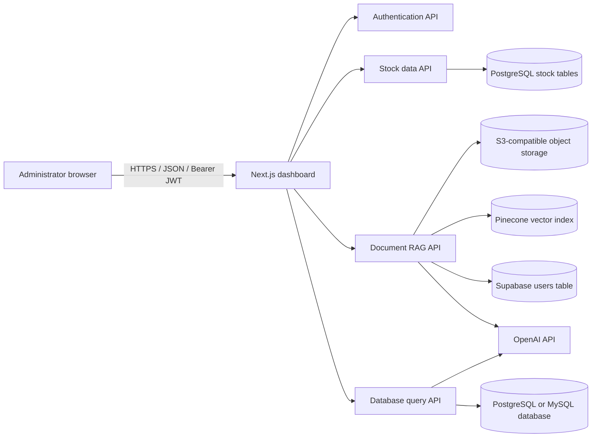

# AI Admin Platform Architecture

## Purpose

AI Admin combines a browser-based admin dashboard with dedicated services for authentication, stock analytics, document question answering, and database querying. The frontend is the presentation layer; each backend owns a domain and connects to its required data stores or AI providers.

## System context



The APIs are independent FastAPI processes. The frontend calls them directly from the browser using configured base URLs; it is not a backend-for-frontend proxy. Thus URLs must be reachable from the user's browser, and CORS must allow the deployed frontend origin.

## Services

| Service | Responsibility | Integrations |
| --- | --- | --- |
| `ai-admin-dashboard` | Dashboard pages, stock charts, login UI, and RAG/DAG panels. API clients attach bearer tokens. | Auth, stock, RAG, DAG APIs. |
| `user-server` | Checks one configured admin email and PBKDF2-SHA256 hash; issues an HS256 JWT with an eight-hour expiry. | Shared JWT signing secret. |
| `ai-admin-data-server` | Exposes an allow-list of stock symbols, historical rows, and calculated summaries. | PostgreSQL stock tables. |
| `ai-admin-rag-server` | Uploads and indexes files, retrieves/reranks context, and returns sourced answers. | S3-compatible storage, Pinecone, Supabase, OpenAI. |
| `ai-admin-dag-server` | Discovers schema, checks relevance, generates and validates SQL, executes read-only queries, summarizes results. | PostgreSQL or MySQL, OpenAI. |

The frontend also has AI and TAG API clients, but corresponding backend service directories are absent here. The HR page currently contains illustrative data.

## Authentication flow

1. Browser submits credentials to `POST /auth/login` on `user-server`.
2. Auth verifies the configured email and PBKDF2-SHA256 hash, then returns an HS256 JWT containing `sub`, `iat`, `exp`, and user claims.
3. Dashboard calls `GET /auth/me` to validate the session. Its API clients attach `Authorization: Bearer <token>` to protected backend calls.
4. Protected services validate the token locally with the same `AUTH_JWT_SECRET`; they do not call the auth API for each request.

`GET /healthz` is an unauthenticated liveness response and does not check external dependencies. It is not a readiness probe.

## Feature flows

### Stock dashboard

The frontend requests `GET /stocks`, then calls `GET /stocks/{symbol}` for chart rows and `GET /stocks/{symbol}/summary` for KPIs. The service maps each allowed symbol to a fixed PostgreSQL table and applies date, ordering, and row-limit filters. Expected tables are `tsla_stock_data`, `amzn_stock_data`, `msft_stock_data`, `googl_stock_data`, and `nvda_stock_data`.

### Document RAG

1. `POST /upload_file/` accepts PDF, XLSX, CSV, DOCX, HTML, or TXT up to 20 MiB and stores it in S3-compatible storage.
2. `POST /insert_file/` downloads supported bucket objects to temporary storage, extracts/splits text, embeds it, and writes chunks plus source metadata to Pinecone.
3. `POST /rag_query/` retrieves and reranks chunks, then asks OpenAI to answer only from retrieved text and cite sources. It returns an answer and ordered unique source names.
4. `GET /list_files/` returns filenames and one-hour presigned URLs. `GET /get_users/` and `POST /add_user/` are auxiliary Supabase user-table endpoints, not the admin auth store.

When provisioning an index, note the code expects 1024 dimensions and cosine metric and provisions AWS serverless in `us-east-1` if the index is missing.

### Natural-language SQL (DAG)

1. `POST /query-database` receives a question.
2. LangGraph inspects schema and checks relevance.
3. For relevant questions, an LLM proposes SQL and `sql_safety.py` validates it.
4. It runs in a read-only transaction. PostgreSQL also gets a 10-second statement timeout; results are capped at 500 rows.
5. Failed SQL can trigger bounded rewriting/retries; successful rows are summarized in natural language.

The endpoint fails closed unless `DAG_READ_ONLY_DB_CONFIRMED=true`. That setting is an operator assertion, not a substitute for a read-only DB role.

## API summary

| Service | Routes |
| --- | --- |
| Auth | `POST /auth/login`, `GET /auth/me` |
| Stock data | `GET /stocks`, `GET /stocks/{symbol}`, `GET /stocks/{symbol}/summary` |
| RAG | `POST /upload_file/`, `POST /insert_file/`, `GET /list_files/`, `POST /rag_query/` |
| DAG | `POST /query-database` |
| Liveness | `GET /healthz` on each API; stock service also defines `GET /health`, subject to its app-wide auth dependency. |

## Local setup

Prerequisites: Python 3.13, Node.js 22/npm, PostgreSQL, and credentials for whichever external services are used. Use each service's `.env.example` as the variable-name source of truth. Do not commit populated `.env` files.

### Backend services

From each service directory, in a separate terminal:

```bash
python3.13 -m venv .venv
source .venv/bin/activate
python -m pip install --upgrade pip
python -m pip install -r requirements.txt
cp .env.example .env
# Edit .env with reachable service credentials.
```

Run the service from its directory (suggested ports align with the dashboard example):

```bash
# user-server
uvicorn main:app --reload --host 0.0.0.0 --port 8002
# ai-admin-data-server
uvicorn main:app --reload --host 0.0.0.0 --port 8009
# ai-admin-rag-server
uvicorn main:app --reload --host 0.0.0.0 --port 8083
# ai-admin-dag-server
uvicorn main:app --reload --host 0.0.0.0 --port 8084
```

Set `CORS_ORIGINS=http://localhost:3000` for local browser development. Start only services whose external dependencies and secrets are configured.

### Frontend

```bash
cd ai-admin-dashboard
npm ci
cp .env.example .env.local
npm run dev
```

For the suggested local ports, set in `.env.local`:

```dotenv
NEXT_PUBLIC_AUTH_API_BASE_URL=http://localhost:8002
NEXT_PUBLIC_DATA_SERVER=http://localhost:8009
NEXT_PUBLIC_RAG_API=http://localhost:8083
NEXT_PUBLIC_DAG_API=http://localhost:8084
NEXT_PUBLIC_APP_NAME=GOLD AI Console
NEXT_PUBLIC_DEFAULT_LOCALE=vi
```

The `NEXT_PUBLIC_*` values used for local development are browser-visible and are not secrets. In the Compose deployment, `public/runtime-config.js` reads public API base URLs at container startup, and empty values mean same-origin requests routed through Caddy.

### Illustrative backend environment values

Replace placeholders and generate secrets securely; these are examples, not real credentials.

```dotenv
# Shared across the auth issuer and JWT-validating APIs; >=32 bytes.
AUTH_JWT_SECRET=replace-with-private-random-secret-at-least-32-bytes
CORS_ORIGINS=http://localhost:3000

# user-server
AUTH_ADMIN_EMAIL=admin@example.com
AUTH_ADMIN_NAME=Administrator
AUTH_ADMIN_PASSWORD_HASH=generate-with-python-hash_password.py

# ai-admin-data-server
HOST=127.0.0.1
PORT=5432
DATABASE=stocks
USERNAME=stock_reader
PASSWORD=replace-me

# ai-admin-dag-server
DAG_READ_ONLY_DB_CONFIRMED=false
OPENAI_API_KEY=replace-me
DB_TYPE=postgresql
DB_HOST=127.0.0.1
DB_PORT=5432
DB_NAME=business
DB_USERNAME=dag_read_only
DB_PASSWORD=replace-me

# ai-admin-rag-server
PINECONE_API_KEY=replace-me
PINECONE_INDEX_NAME=ai-admin-documents
SUPABASE_URL=https://your-project.supabase.co
SUPABASE_KEY=replace-me
AWS_ACCESS_KEY_ID=replace-me
AWS_SECRET_ACCESS_KEY=replace-me
S3_BUCKET_NAME=your-private-bucket
OPENAI_API_KEY=replace-me
```

The stock API uses `HOST`, `DATABASE`, `USERNAME`, `PASSWORD`, `PORT`; DAG uses `DB_HOST`, `DB_NAME`, `DB_USERNAME`, `DB_PASSWORD`, `DB_PORT`. These names match their respective code. Generate `AUTH_ADMIN_PASSWORD_HASH` with `python hash_password.py` in `user-server/`.

### Suggested startup order

1. Configure PostgreSQL and external services (S3-compatible storage, Pinecone, Supabase, OpenAI access).
2. Start `user-server`; verify `GET /healthz`.
3. Start stock, RAG, and DAG APIs after configuring each dependency and the shared JWT secret.
4. Start the dashboard and log in with the configured admin account.

## Docker Compose deployment

The root `compose.yaml` runs the dashboard, all four APIs, and Caddy on one VM. PostgreSQL/MySQL, S3-compatible storage, Pinecone, Supabase, and OpenAI remain external services. Backend containers share a private Docker network; Caddy is the only service publishing host ports.

### Configure and start

1. Copy the Compose settings template to `.env` in the workspace root and set a release tag/domain as needed:

  ```bash
  cp .env.compose.example .env
  ```

2. Create and configure each backend's runtime environment file:

  ```bash
  cp user-server/.env.example user-server/.env
  cp ai-admin-data-server/.env.example ai-admin-data-server/.env
  cp ai-admin-rag-server/.env.example ai-admin-rag-server/.env
  cp ai-admin-dag-server/.env.example ai-admin-dag-server/.env
  ```

  Use one strong `AUTH_JWT_SECRET` across the auth and protected APIs. Configure database hosts using addresses reachable from containers (for example `host.docker.internal` when a database is on the macOS host; use private DNS/service names in production). Configure providers and set the DAG read-only confirmation only after verifying actual DB grants.

3. Build and launch the stack from the workspace root:

  ```bash
  docker compose config
  docker compose up --build -d
  docker compose ps
  docker compose logs -f
  ```

4. With the default `CADDY_SITE=:80`, access the app over HTTP at `http://localhost`. For a public VM, point DNS to the VM, set `CADDY_SITE=your-domain.example`, open TCP ports 80/443 (and optionally UDP 443), then restart Compose; Caddy will provision HTTPS certificates. The default Compose mapping publishes 80 and 443.

### Routing and runtime settings

- The dashboard loads `/runtime-config.js` before hydration. Its `PUBLIC_*_BASE_URL` environment variables are public API URLs, not secrets. Leave them empty to use same-origin API paths through Caddy.
- Caddy routes `/auth/*` to auth, `/stocks*` to data, RAG endpoint paths to RAG, and `/query-database` to DAG; all other paths go to the dashboard. Service API paths are preserved.
- The backends are not published directly to the host. Use Compose DNS names (`auth`, `data`, `rag`, `dag`) for container-to-container calls and private external service DNS for database connectivity.
- Caddy persists certificate/configuration state in named volumes. The RAG service persists the Hugging Face model cache in `rag-model-cache`; first use downloads the model and can be slower. The cache and containers need sufficient disk/RAM/CPU, especially during RAG indexing.
- `/healthz` in Caddy checks only that the proxy is responding. Container health checks on backend services call their local liveness endpoint; they do not prove external DB/provider readiness.

### Operations

```bash
docker compose ps
docker compose logs -f auth data rag dag dashboard proxy
docker compose up -d
docker compose down
```

For rollback, set `APP_IMAGE_TAG` to the previous immutable image tag in root `.env`, then pull and start that version. Local builds use the `local` tag by default. To publish to a generic OCI registry, set a registry namespace and release tag in root `.env`, authenticate with the registry, then:

```bash
docker compose build auth data rag dag dashboard
docker compose push auth data rag dag dashboard
```

On a VM that has the repository checkout and deployment `.env` files, deploy the published release with:

```bash
docker compose pull auth data rag dag dashboard
docker compose up -d --no-build
```

For example, `IMAGE_PREFIX=ghcr.io/your-org/ai-admin` and `APP_IMAGE_TAG=1.0.0` select images like `ghcr.io/your-org/ai-admin-rag:1.0.0`. Keep tags immutable and do not use `latest` for rollback-sensitive deployments. The checked-out Compose file also retains build contexts for local builds.

### VM/cloud production checklist

- Install Docker Engine and the Compose plugin on a supported Linux VM. The same images and Compose layout can run on a VM from any cloud; provider-specific firewalls, DNS, VM sizing, and secret-management integrations remain deployment tasks.
- Use a DNS hostname for `CADDY_SITE`; allow inbound TCP 80/443 for ACME/TLS and redirect HTTP to HTTPS through Caddy.
- Keep backend ports private, restrict SSH/admin access, and do not expose database or storage services publicly.
- Supply backend credentials through a secret manager or protected deployment environment. Do not commit populated `.env` files. Rotate the shared JWT secret consistently across issuer and validators.
- Use unique least-privilege database accounts. The DAG account must be read-only even with application SQL checks and read-only transactions.
- Restrict CORS to exact browser origins if using cross-origin API URLs. Same-origin proxy routing generally avoids browser CORS preflights.
- Permit outbound connectivity to PostgreSQL/MySQL, object storage, Pinecone, Supabase, OpenAI, and the model host used by Hugging Face. The RAG model is downloaded at first use and cached on the named volume.
- Back up external databases and any business data according to their own policies. Caddy state and the RAG model cache are stored in named volumes; the model cache is reconstructible, while the certificate state reduces unnecessary reissuance.
- Monitor container health/logs, VM disk/memory, and external dependencies. `/healthz` is liveness only, not readiness.
- Pin release image tags and test upgrades/rollback. Compose is a single-VM baseline; multi-node HA requires an orchestrator and a separate design.

### Production checklist

- Terminate TLS at a trusted ingress/reverse proxy and publish only dashboard and required API routes.
- Restrict CORS to exact frontend origins; avoid wildcard origins when credentials are enabled.
- Use a high-entropy JWT secret of at least 32 bytes and keep it consistent across issuer/validators. Store it and all provider/DB keys in a secret manager, not source or image layers.
- Use unique least-privilege DB accounts. The DAG account must be read-only even with application SQL checks and read-only transactions.
- Restrict PostgreSQL, object storage, Pinecone, and Supabase network/access policies; permit only required outbound calls.
- Ensure the Pinecone index matches the expected 1024-dimensional embedding configuration and region.
- Monitor logs and dependencies. `/healthz` checks liveness only, not readiness.
- Set resource limits and suitable request timeouts; indexing and LLM calls can take longer than ordinary requests.
- Rebuild the dashboard after changing public API URLs.

## Operational boundaries

- Stock API expects the symbol tables to exist; CSV files under `ai-admin-data-server/data/` are not imported automatically at API startup.
- RAG indexing scans supported objects in the configured bucket when triggered; plan re-indexing and vector lifecycle accordingly.
- DAG supports PostgreSQL and MySQL according to `DB_TYPE`; compatibility still depends on target schema and drivers.
- Only RAG and DAG backends are present for the AI Query feature; TAG/AI API clients are not backed by services in this workspace.
