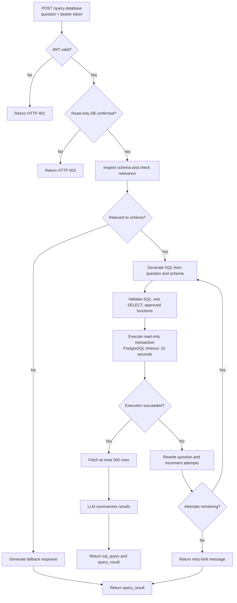

# Database query agent (`ai-admin-dag-server`)

FastAPI service that turns database questions into guarded, read-only SQL workflows. It uses LangGraph for orchestration and an OpenAI-backed model for relevance checking, SQL generation, question rewriting, and final answer phrasing.

## Workflow and purpose

For `POST /query-database`, the agent:

1. Inspects the configured database schema and checks question relevance.
2. Generates SQL for relevant questions.
3. Validates the query with `sql_safety.py` before execution.
4. Starts a read-only transaction; PostgreSQL also receives a 10-second statement timeout. Results are limited to 500 rows.
5. Summarizes successful results. On SQL errors it may rewrite the question and retry within a bounded attempt count.

The endpoint returns `query_result` and `sql_query`. Configure the database account itself with read-only privileges: the confirmation flag and application checks are defense-in-depth, not a replacement for least privilege.

### Workflow diagram



## Environment variables

Copy `.env.example` to `.env` and set:

| Variable | Required | Description |
| --- | --- | --- |
| `AUTH_JWT_SECRET` | Yes | Shared HS256 secret used by `user-server` and protected APIs; at least 32 bytes. |
| `CORS_ORIGINS` | No | Comma-separated browser origins; defaults to localhost ports 3000 and 3003. |
| `DAG_READ_ONLY_DB_CONFIRMED` | For queries | Must be `true` (case-insensitive) after confirming DB account permissions; otherwise `/query-database` returns 503. Default: `false`. |
| `OPENAI_API_KEY` | Yes | OpenAI credential. |
| `OPENAI_MODEL` | No | Model for the LangChain workflow; defaults to `gpt-5-mini`. |
| `DB_TYPE` | No | `postgresql` (default) or `mysql`; other values fail startup. |
| `DB_HOST` | Yes | Database host; use `127.0.0.1` for local host-based development or private service DNS in containers. |
| `DB_PORT` | No | Database port; usually PostgreSQL `5432` or MySQL `3306`. |
| `DB_NAME` | Yes | Database/catalog to inspect. |
| `DB_USERNAME` | Yes | Database user; grant only required read and metadata access. |
| `DB_PASSWORD` | Yes | Database password. |

Illustrative values only:

```dotenv
AUTH_JWT_SECRET=replace-with-private-random-value-at-least-32-bytes
CORS_ORIGINS=http://localhost:3000
DAG_READ_ONLY_DB_CONFIRMED=false
OPENAI_API_KEY=replace-me
OPENAI_MODEL=gpt-5-mini
DB_TYPE=postgresql
DB_HOST=127.0.0.1
DB_PORT=5432
DB_NAME=business
DB_USERNAME=dag_read_only
DB_PASSWORD=replace-me
```

Set `DAG_READ_ONLY_DB_CONFIRMED=true` only after validating the account's actual grants.

## Run locally

From this directory:

```bash
python3.13 -m venv .venv
source .venv/bin/activate
python -m pip install --upgrade pip
python -m pip install -r requirements.txt
cp .env.example .env
# Configure a reachable database and verify the DB account is read-only.
uvicorn main:app --reload --host 0.0.0.0 --port 8084
```

Suggested dashboard base URL: `http://localhost:8084`. Application routes require a valid bearer JWT; `GET /healthz` is unauthenticated liveness.

Run SQL safety tests:

```bash
python -m unittest test_sql_safety.py
```

## API

- `POST /query-database` — JSON body `{"question":"..."}`; returns generated SQL and an answer/result string.
- `GET /healthz` — liveness probe.

## Docker

Build from this directory. A database on the macOS host is usually addressed from a container as `host.docker.internal`, not `localhost`.

```bash
docker build -t ai-admin-dag .
docker run --rm --name ai-admin-dag --env-file .env -p 8084:8000 ai-admin-dag
```

The container listens on port 8000 internally and runs as an unprivileged user. Supply production secrets through a secret manager. Do not expose the database publicly, and grant this service only the read and metadata permissions needed.

## Safety and operations

- SQL validation is dialect-aware for supported PostgreSQL/MySQL configurations; review changes to validation logic before deployment.
- Read-only transactions and validation do not replace database grants, which remain the strongest boundary.
- Questions, SQL, and result values may be sent to the configured LLM. Apply data minimization and do not query data that is not approved for that provider.
- Restrict visible schemas/tables to the use case.
